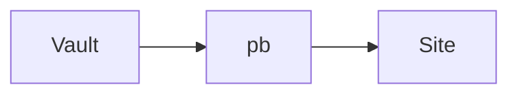

# Demo Deck :rocket:

Built from an Obsidian vault with ==Paulblish==

note: Speaker notes are public on the published site. Press S to open the speaker view.

---

## Fragments

+ Appears first
+ Appears second
+ Appears third

--

## Vertical slide

1) One
2) Two

---

<!-- slide bg="#2d3e50" -->

<grid drag="100 20" drop="0 5">
## Grid layout
</grid>

<grid drag="40 50" drop="5 35" bg="coral" pad="1em">
Left column
</grid>

<grid drag="40 50" drop="55 35" border="thick dotted white" flow="row">
![[pb-logo.svg|120]]
</grid>

---

## Callouts and blocks

> [!tip] Wikilinks
> Links resolve to published pages: [[Simple Article]]

::: block <!-- element style="background-color: #444; padding: 0.5em" -->
A block with inline styling

:fas_check:
:::

---

## Code, maths and footnotes

```python [2]
def greet(name):
    return f"Hello, {name}"
```

Inline maths $e^{i\pi} + 1 = 0$ and a footnote[^1].

[^1]: Footnotes collect at the bottom of the slide.

---

## Diagram



---

## Chart

```chart
type: bar
labels: [Mon, Tue, Wed]
series:
- title: Visitors
  data: [3, 5, 2]
```

---

<!-- slide template="[[footer-template]]" -->

## Templated slide

::: footer
Built with Paulblish
:::

---

<!-- slide skip="true" -->

## This slide is hidden
